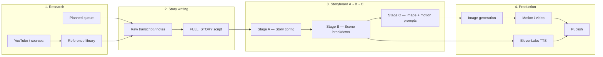
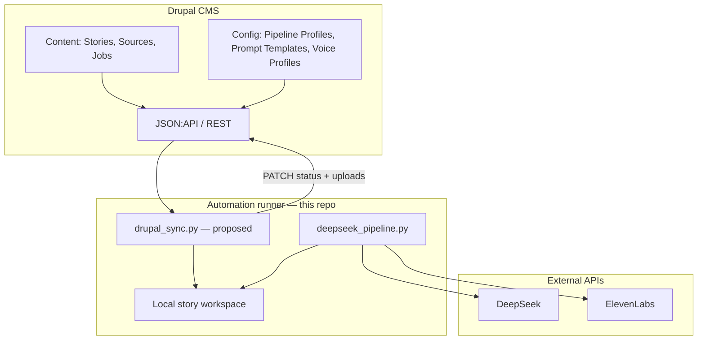
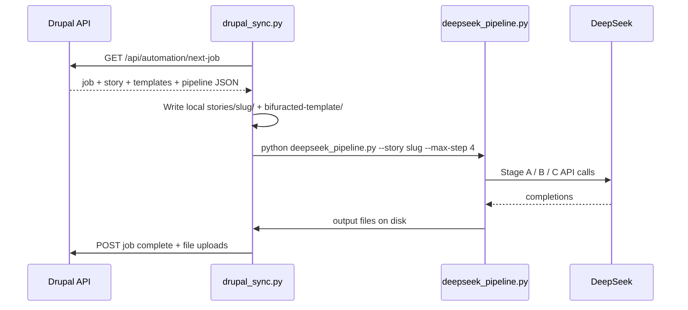

# Research Story Automation — Project Overview & Drupal Integration Plan

This repository automates the production pipeline for **2D documentary-style animated videos**: from research and raw scripts through AI storyboard generation (image + motion prompts) and optional voice synthesis. Today everything runs as **local files + shell scripts + Python**; this document describes the **full process** and a **target architecture** where **Drupal holds configuration and content**, exposing **REST/JSON:API endpoints** that this automation system consumes.

---

## Table of contents

1. [End-to-end workflow](#end-to-end-workflow)
2. [Pipeline packages in this repo](#pipeline-packages-in-this-repo)
3. [Story lifecycle & artefacts](#story-lifecycle--artefacts)
4. [What runs today (file-based)](#what-runs-today-file-based)
5. [Target architecture: Drupal as control plane](#target-architecture-drupal-as-control-plane)
6. [Drupal content model (proposed)](#drupal-content-model-proposed)
7. [API surface (proposed)](#api-surface-proposed)
8. [How the automation client uses Drupal](#how-the-automation-client-uses-drupal)
9. [Migration phases](#migration-phases)
10. [Environment & secrets](#environment--secrets)
11. [Further reading](#further-reading)

---

## End-to-end workflow



| Phase | Purpose | Current location | Future (Drupal) |
|-------|---------|------------------|-----------------|
| **Research** | Collect competitor/reference transcripts, metadata, planned topics | `library/`, `planned/` | Media + Story Source nodes, Research Queue |
| **Story writing** | Turn raw material into a finished narration script | `story-to-run/`, `story-making-prompts/` | Story node (`field_full_story`), Story Writing Prompt config |
| **Storyboard** | Lock visual rules, split into ~5s scenes, emit render prompts | `*/stories/<slug>/`, `*/bifuracted-template/` | Story node revisions + Prompt Template config |
| **Audio** | Scene-by-scene Hindi/English voice | `elevenlabs-audio/` | Story node + Voice Profile config |
| **Orchestration** | Batch runs, model settings, overwrite flags | `run_with_params.sh`, `*.ini`, `queue.txt` | Pipeline Job entities + Pipeline Profile config |

---

## Pipeline packages in this repo

Three **independent packages** share one engine (`crime-section/helper/deepseek_pipeline.py`) but use **different prompt templates** and output conventions:

| Package | Language / genre | Detailed docs |
|---------|------------------|---------------|
| [`crime-section/`](crime-section/README.md) | Hindi/Hinglish true crime, mystery, paranormal | Stage A/B/C tuned for crime visual conventions |
| [`general-story/`](general-story/README.md) | Hindi/Hinglish general documentary / history | Same 3-stage flow; batch queue via `queue.txt` |
| [`english-story/`](english-story/README.md) | English narratives | Also writes `scene.txt` + `image-prompts-only.txt` |

**Shared engine behaviour**

| Step | Action | LLM? | Output |
|------|--------|------|--------|
| **1** | Create story folder, sync script, copy templates | No | `FULL_STORY.txt`, `template/*` |
| **2** | Stage A — story config block | Yes | `output_config_<slug>.md` |
| **3** | Stage B — locked scene breakdown | Yes | `output_story_breakdown_<slug>.md` |
| **4** | Stage C — batched image + motion prompts | Yes | `prompt.txt` (+ derivatives) |

Run locally (example — crime section):

```bash
# Prerequisites: Python 3, pip install -r crime-section/requirements-deepseek.txt
# Repo-root .env with DEEPSEEK_API_KEY

chmod +x crime-section/run_with_params.sh
./crime-section/run_with_params.sh
```

Batch mode: list stories in `*/story-to-run/queue.txt` as `slug|path-to-script` (one per line).

---

## Story lifecycle & artefacts

Each episode (identified by a **slug**, e.g. `london-case`) accumulates these artefacts:

```
stories/<slug>/
├── FULL_STORY.txt                      ← canonical narration script
├── output_config_<slug>.md             ← Stage A (era, characters, lighting rules)
├── output_story_breakdown_<slug>.md      ← Stage B (Scene 1…N, Hindi/English lines)
├── prompt.txt                          ← Stage C (IMAGE PROMPT + DIGEN MOTION PROMPT)
├── scene.txt                           ← (english-story) headings + narration lines
├── image-prompts-only.txt              ← (english-story) one image prompt per line
└── template/
    ├── STORY_Config_<slug>.md          ← Stage A template mirror (debug / manual)
    ├── Story_scene_breakdown_<slug>.md
    ├── <slug>_stage-c-image-motion.md
    └── character.txt                   ← optional locked character library
```

**Slug consistency is critical.** Folder name, output filenames, and template suffixes must all match (e.g. `london-case` everywhere).

---

## What runs today (file-based)

### Configuration (should move to Drupal)

| File | Contents |
|------|----------|
| `*/deepseek.config.example.ini` | Model, token budgets, batch size, Stage B segmentation, temperature, progress UI |
| `*/run_with_params.sh` | Story slug, max step (1–4), overwrite, queue path, character library flag |
| `*/story-to-run/queue.txt` | Batch queue: `slug\|story-file-path` |
| `*/bifuracted-template/stage-*.md` | Stage A/B/C prompt specifications (thousands of lines) |
| `story-making-prompts/*` | Upstream story-writing master prompts (crime, general, English) |
| Repo `.env` | `DEEPSEEK_API_KEY`, `ANTHROPIC_API_KEY`, `ELEVENLABS_API_KEY` |

### Content (should live in Drupal, synced to disk for runs)

| Path | Contents |
|------|----------|
| `*/story-to-run/*.txt` | Scripts waiting to be processed |
| `library/<category>/stories/` | Reference transcripts from YouTube |
| `library/<category>/metadata/videos.json` | Video metadata index |
| `planned/` | Topic backlog / source URLs |

### Automation scripts (stay in this repo)

| Script | Role |
|--------|------|
| `crime-section/helper/deepseek_pipeline.py` | Core DeepSeek OpenAI-compatible runner |
| `*/run_with_params.sh` | Human-friendly launcher |
| `library/fetch_youtube_transcript.py` | Pull transcripts into `library/` |
| `elevenlabs-audio/generate_audio.py` | TTS from Stage B breakdown or raw script |

---

## Target architecture: Drupal as control plane



**Principles**

1. **Drupal owns truth** for prompts, pipeline settings, story text, queue order, and run status.
2. **This repo owns execution** — LLM calls, file merging, batching, retries, progress UI.
3. **Sync before run, push after run** — the runner downloads job payload + templates, writes local files the engine already understands, then uploads outputs back to Drupal.
4. **Secrets stay out of Drupal** — API keys remain in the runner’s `.env` or a secrets manager; Drupal stores only non-secret pipeline defaults.

---

## Drupal content model (proposed)

### Config entities (exportable, versioned)

| Entity | Machine name | Fields / purpose |
|--------|--------------|------------------|
| **Pipeline profile** | `pipeline_profile` | Package (`crime-section` \| `general-story` \| `english-story`), `max_step`, model, token budgets, `scene_batch`, Stage B segment settings, overwrite defaults |
| **Prompt template — Stage A** | `prompt_template_stage_a` | Body (markdown), package, version, `PH_*` placeholder docs |
| **Prompt template — Stage B** | `prompt_template_stage_b` | Same |
| **Prompt template — Stage C** | `prompt_template_stage_c` | Same |
| **Story writing prompt** | `story_writing_prompt` | Master prompt for turning research → script (maps to `story-making-prompts/`) |
| **Voice profile** | `voice_profile` | ElevenLabs voice ID, model, language, chunk size |

Store templates as **long text** or **managed files** with revision history so editors can diff prompt changes without touching Git.

### Content entities (operational)

| Entity | Machine name | Key fields |
|--------|--------------|------------|
| **Story source** | `story_source` | YouTube URL, transcript text, metadata JSON, category (`crime` \| `general`), reference channel |
| **Story** | `story` | `slug`, `field_full_story`, `field_character_library`, package, pipeline profile reference, status (`draft` → `script_ready` → `config_done` → `breakdown_done` → `prompts_done` → `audio_done`), Stage A/B/C output fields (or file attachments), queue weight |
| **Pipeline job** | `pipeline_job` | Story reference, requested `max_step`, `force`, started/finished timestamps, log text, error message |

Optional: **Channel** taxonomy for grouping sources (e.g. “Crime Ki Kahani”).

---

## API surface (proposed)

Use **JSON:API** (Drupal core) for CRUD and a few **custom REST resources** for runner-specific operations.

### Read — runner pulls work

| Method | Endpoint | Returns |
|--------|----------|---------|
| `GET` | `/jsonapi/node/story?filter[status]=script_ready&sort=field_queue_weight` | Stories queued for storyboard step 2+ |
| `GET` | `/jsonapi/node/story/{uuid}` | Full story payload: script, character library, slug, package |
| `GET` | `/jsonapi/pipeline_profile/pipeline_profile/{id}` | INI-equivalent settings as JSON |
| `GET` | `/jsonapi/prompt_template_stage_a/...` (×3 stages) | Template markdown for the story’s package + version |
| `GET` | `/api/automation/next-job` | **Custom:** atomically claim next pending `pipeline_job` (avoid double runs) |

Example merged job payload (custom resource):

```json
{
  "job_id": "9f3a…",
  "story": {
    "slug": "london-case",
    "package": "crime-section",
    "full_story": "…",
    "character_library": "…",
    "status": "script_ready"
  },
  "pipeline": {
    "max_step": 4,
    "force": false,
    "model": "deepseek-v4-pro",
    "max_tokens_stage_a": 65536,
    "scene_batch": 8
  },
  "templates": {
    "stage_a": "…markdown…",
    "stage_b": "…markdown…",
    "stage_c": "…markdown…"
  }
}
```

### Write — runner pushes results

| Method | Endpoint | Body |
|--------|----------|------|
| `PATCH` | `/jsonapi/node/story/{uuid}` | Update status, attach `field_stage_a_output`, etc. |
| `POST` | `/api/automation/job/{id}/complete` | `{ "outputs": { "stage_a": "…", "prompt_txt": "…" }, "status": "prompts_done" }` |
| `POST` | `/api/automation/job/{id}/fail` | `{ "error": "Stage B finish_reason=length" }` |

File-heavy outputs (`prompt.txt`) can be **managed files** on the Story node rather than inline JSON.

### Admin — editors manage queue

| Method | Endpoint | Purpose |
|--------|----------|---------|
| `GET` | `/jsonapi/node/story?sort=field_queue_weight` | Ordered production queue |
| `POST` | `/jsonapi/node/story` | Create story from source + script |
| `PATCH` | `/jsonapi/node/story/{uuid}` | Reorder queue, change pipeline profile |

**Authentication:** OAuth2 / API key for the runner service account; role-based permissions so only automation can claim jobs and write outputs.

---

## How the automation client uses Drupal

A thin **sync layer** (proposed: `helper/drupal_sync.py` in each package, or one shared module) sits between Drupal and the existing engine.



**Mapping Drupal → local (no engine changes required initially)**

| Drupal field | Local path |
|--------------|------------|
| `field_full_story` | `stories/<slug>/FULL_STORY.txt` |
| `field_character_library` | `stories/<slug>/template/character.txt` |
| Prompt template Stage A/B/C | `bifuracted-template/stage-*.md` (or per-story `template/`) |
| Pipeline profile | Generated `deepseek.config.runtime.ini` or env vars |
| Job `max_step`, `force` | CLI args to `deepseek_pipeline.py` |

**Mapping local → Drupal after run**

| Local file | Drupal field |
|------------|--------------|
| `output_config_<slug>.md` | `field_stage_a_output` |
| `output_story_breakdown_<slug>.md` | `field_stage_b_output` |
| `prompt.txt` | `field_prompt_file` (managed file) |
| `scene.txt`, `image-prompts-only.txt` | Optional attachments (english-story) |

**Runner invocation (future)**

```bash
# Poll Drupal, run one job, push results
python3 crime-section/helper/drupal_runner.py \
  --drupal-base https://cms.example.com \
  --api-key "$DRUPAL_API_KEY"

# Or: sync a specific story then run existing shell script
python3 crime-section/helper/drupal_sync.py pull --story london-case
./crime-section/run_with_params.sh
python3 crime-section/helper/drupal_sync.py push --story london-case
```

---

## Migration phases

| Phase | Scope | Outcome |
|-------|-------|---------|
| **0 — Today** | Files + shell scripts | Fully working local pipeline (see package READMEs) |
| **1 — Drupal CMS** | Content types, editorial UI, JSON:API | Stories, sources, and queue managed in Drupal; manual export/import |
| **2 — Config in Drupal** | Pipeline profiles + prompt templates | Replace INI + bifurcated-template edits with Drupal config entities |
| **3 — Sync client** | `drupal_sync.py` pull/push | Runner reads/writes Drupal instead of hand-editing `story-to-run/` |
| **4 — Job queue** | `pipeline_job` + claim endpoint | Unattended worker polls Drupal, runs steps, reports status |
| **5 — Research loop** | Source ingestion API | `fetch_youtube_transcript.py` posts to Drupal; planned topics become Story drafts |

Start with **Phase 1–2** if the immediate goal is a **single place to edit prompts and queue stories**; add Phase 3–4 when you want **hands-off batch runs**.

---

## Environment & secrets

| Variable | Used by | Store in Drupal? |
|----------|---------|----------------|
| `DEEPSEEK_API_KEY` | Storyboard pipeline | **No** — runner `.env` only |
| `ANTHROPIC_API_KEY` | Optional Claude path | **No** |
| `ELEVENLABS_API_KEY` | TTS | **No** |
| `DRUPAL_BASE_URL` | Sync client | Yes (non-secret site URL) |
| `DRUPAL_API_KEY` or OAuth client | Sync client | **No** — runner secrets |
| `DEEPSEEK_CONFIG_PATH` | Override INI path | Optional; superseded by Drupal pipeline profile in Phase 2 |

Repo-root `.env` (never commit):

```env
DEEPSEEK_API_KEY=sk-…
DRUPAL_BASE_URL=https://cms.example.com
DRUPAL_API_KEY=…
ELEVENLABS_API_KEY=…
```

---

## Further reading

| Topic | Document |
|-------|----------|
| **Drupal — simple flow (start here)** | [`docs/drupal-story-pipeline/SIMPLE-FLOW.md`](docs/drupal-story-pipeline/SIMPLE-FLOW.md) |
| Drupal — full implementation guide | [`docs/drupal-story-pipeline/README.md`](docs/drupal-story-pipeline/README.md) |
| Crime-section pipeline (steps, layout, DeepSeek) | [`crime-section/README.md`](crime-section/README.md) |
| General documentary pipeline + batch queue | [`general-story/README.md`](general-story/README.md) |
| English pipeline + extra outputs | [`english-story/README.md`](english-story/README.md) |
| Stage A/B/C semantics & character library | [`crime-section/bifuracted-template/README.md`](crime-section/bifuracted-template/README.md) |
| Skeleton scripts & Claude automation | [`crime-section/helper/README.md`](crime-section/helper/README.md) |
| YouTube transcript library | [`library/fetch_youtube_transcript.py`](library/fetch_youtube_transcript.py) |
| ElevenLabs TTS | [`elevenlabs-audio/generate_audio.py`](elevenlabs-audio/generate_audio.py) |

---

## Quick reference — manual run today

1. Put finished script in `*/story-to-run/` (or add line to `queue.txt`).
2. Edit `*/run_with_params.sh` (`MY_FOLDER_NAME`, `MY_PIPELINE_STEP`, `MY_OVERWRITE`).
3. Ensure repo-root `.env` has `DEEPSEEK_API_KEY`.
4. Run `./<package>/run_with_params.sh` from repo root.
5. Collect outputs from `*/stories/<slug>/`.

Once Drupal is live, steps 1–2 move to the CMS; steps 4–5 stay the same locally until the sync client is wired in.
