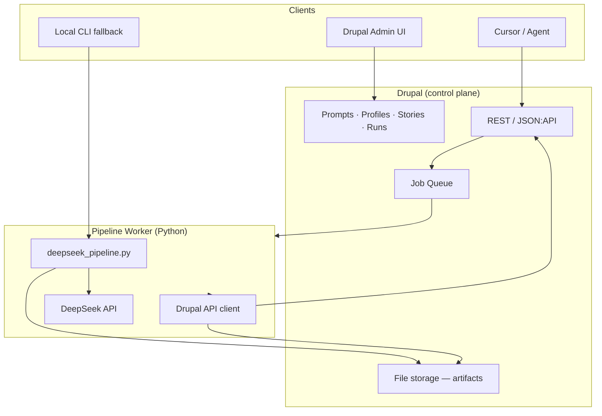
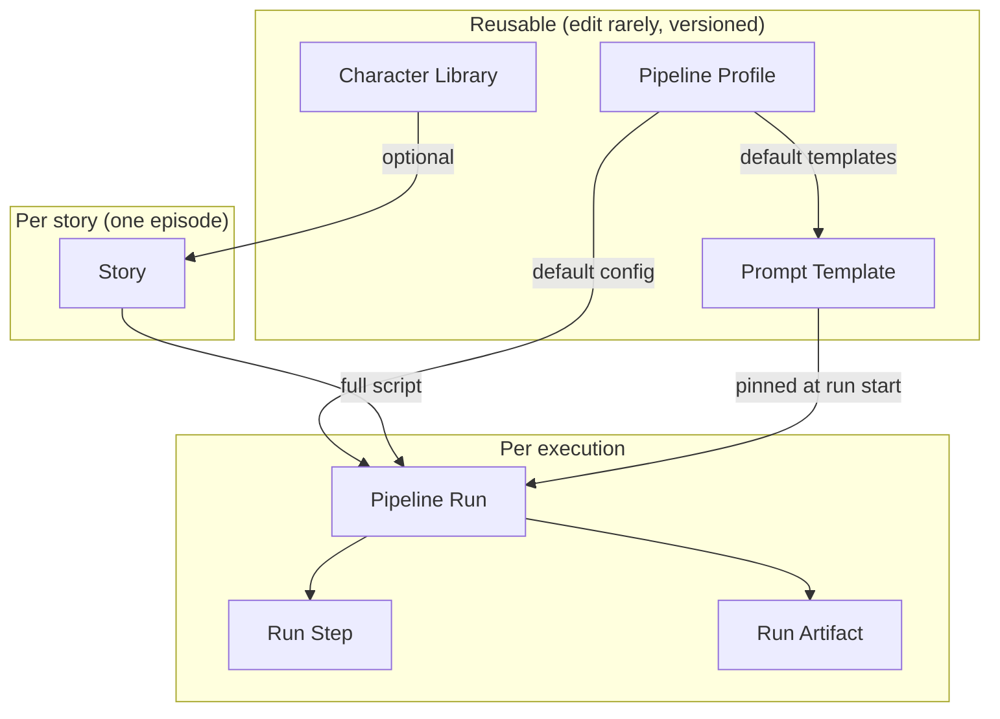
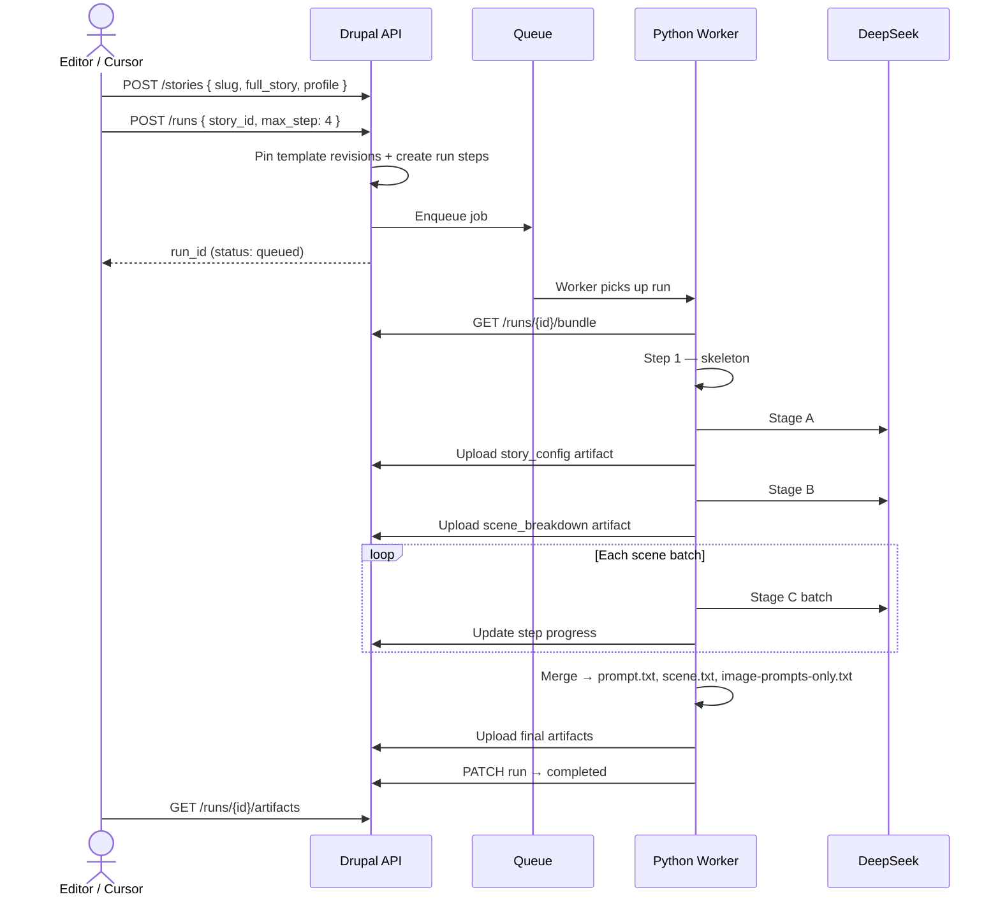
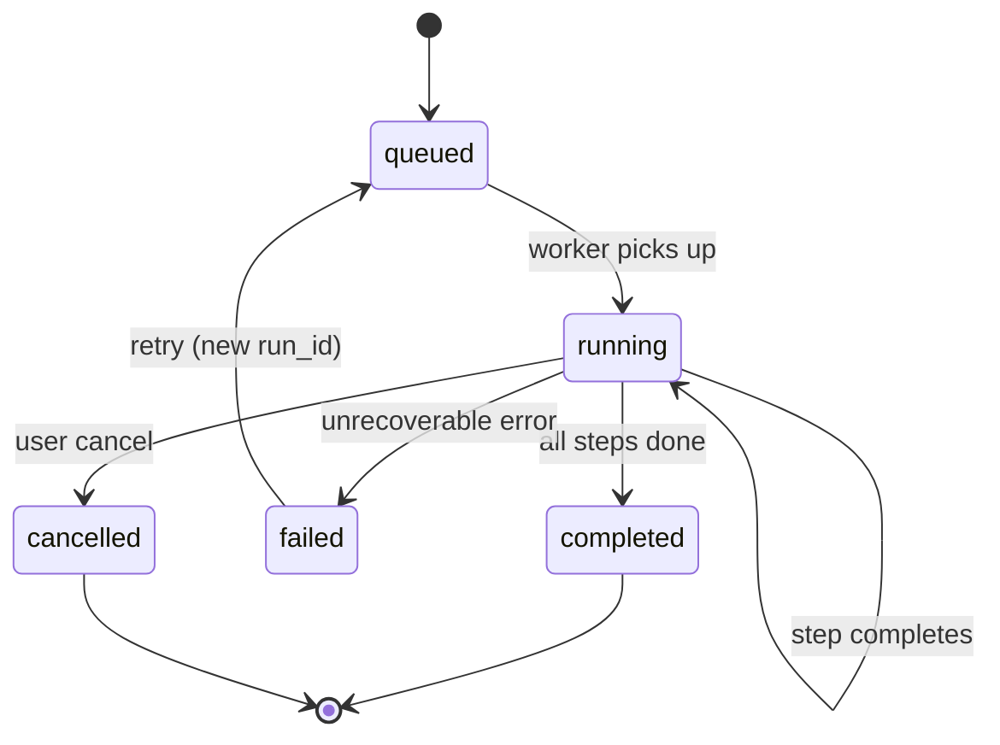
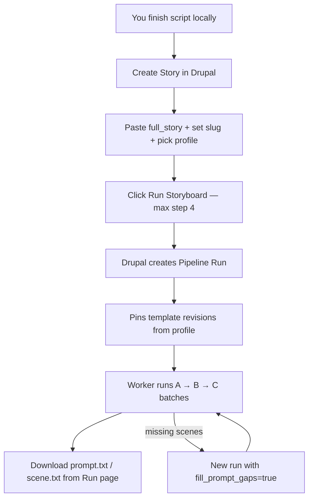

# Drupal Storyboard Pipeline — Design & Implementation Guide

> **Prefer a simpler setup?** See **[SIMPLE-FLOW.md](./SIMPLE-FLOW.md)** — one taxonomy (General/Crime/English) holds all prompts, one Story content type, two pipelines (generate story + storyboard). Start there unless you need full run tracking and version pinning.

This document describes the **detailed** architecture: separate content types for templates, runs, and artifacts. Use it when you outgrow the simple model.

Script writing can stay outside Drupal — or use Pipeline 1 in SIMPLE-FLOW.md (YouTube → transcripts → master prompt).

**Related repo paths (existing):**

| Path | Role |
|------|------|
| `crime-section/helper/deepseek_pipeline.py` | Shared DeepSeek engine (do not fork) |
| `general-story/helper/deepseek_pipeline.py` | Launcher with `--crime-root` |
| `{profile}/bifuracted-template/` | Stage A/B/C templates + `character.txt` |
| `{profile}/deepseek.config.example.ini` | Pipeline config (maps to Drupal Profile) |
| `drupal-worker/` | Python worker (to be built — polls Drupal, runs engine) |

**Profiles:** `general-story`, `crime-section`, `english-story`

---

## Table of contents

1. [Architecture overview](#1-architecture-overview)
2. [What gets stored where](#2-what-gets-stored-where)
3. [Drupal content types](#3-drupal-content-types)
4. [Data flow](#4-data-flow)
5. [REST API](#5-rest-api)
6. [Python worker](#6-python-worker)
7. [Implementation phases](#7-implementation-phases)
8. [Seed data import](#8-seed-data-import)
9. [Daily workflow](#9-daily-workflow)
10. [Cursor / agent workflow](#10-cursor--agent-workflow)
11. [Testing checklist](#11-testing-checklist)
12. [Deployment notes](#12-deployment-notes)
13. [Placeholder contract](#13-placeholder-contract)

---

## 1. Architecture overview



**Principle:** Drupal owns *what* to run and *where results live*. The Python worker owns *how* to run it (LLM calls, batching, retries).

| Layer | Responsibility |
|-------|----------------|
| **Drupal** | Prompt library, story registry, run orchestration, artifact store, batch queue |
| **Worker** | Existing `deepseek_pipeline.py` + thin Drupal API client |
| **Clients** | Drupal UI (humans), REST API (Cursor), optional local bash CLI |

**Do not run the full DeepSeek pipeline inside Drupal PHP.** PHP handles CMS + queue; Python handles long LLM work.

---

## 2. What gets stored where



| Bucket | Drupal content type | Purpose |
|--------|----------------------|---------|
| **Config** | `pipeline_profile` | Model, tokens, batch size — replaces INI file |
| **Prompts** | `prompt_template` | Stage A/B/C markdown bodies (versioned) |
| **Characters** | `character_library` | Shared `character.txt` content |
| **Input** | `story` | Your finished script + metadata |
| **Execution** | `pipeline_run` | One A→B→C job |
| **Traceability** | `run_step` | Each stage/batch status |
| **Output** | `run_artifact` | config, breakdown, prompt.txt, etc. |

**Not stored in Drupal:**

- Script-writing master prompts (`story-making-prompts/`) — you write scripts yourself
- `DEEPSEEK_API_KEY` — stays on the worker machine only

---

## 3. Drupal content types

Custom module: **`story_pipeline`** (Drupal 10/11)

### 3.1 `pipeline_profile`

One node per package: `general-story`, `crime-section`, `english-story`.

| Field label | Machine name | Type | Required | Default / notes |
|-------------|--------------|------|----------|-----------------|
| Title | `title` | core title | yes | Human label |
| Machine name | `field_machine_name` | Text (plain) | yes | Unique |
| Default Stage A | `field_default_stage_a` | Entity ref → `prompt_template` | yes | |
| Default Stage B | `field_default_stage_b` | Entity ref → `prompt_template` | yes | |
| Default Stage C | `field_default_stage_c` | Entity ref → `prompt_template` | yes | |
| Default character library | `field_default_character_lib` | Entity ref → `character_library` | no | |
| LLM model | `field_llm_model` | Text | yes | `deepseek-v4-pro` |
| Base URL | `field_llm_base_url` | Text | yes | `https://api.deepseek.com` |
| Temperature | `field_temperature` | Decimal | yes | `0.3` |
| Thinking enabled | `field_thinking_enabled` | Boolean | yes | `true` |
| Reasoning effort | `field_reasoning_effort` | List | yes | max, high, medium, low |
| Max tokens Stage A | `field_max_tokens_a` | Integer | yes | `65536` |
| Max tokens Stage B | `field_max_tokens_b` | Integer | yes | `131072` |
| Max tokens Stage C | `field_max_tokens_c` | Integer | yes | `65536` |
| Scene batch size | `field_scene_batch` | Integer | yes | `8` |
| Stage C batch retries | `field_stage_c_retries` | Integer | yes | `3` |
| Stage C min chars/scene | `field_stage_c_min_chars` | Integer | yes | `1200` |
| Stage B story segments | `field_stage_b_segments` | Integer | yes | `10` |
| Stage B min chars/segment | `field_stage_b_min_chars` | Integer | yes | `2600` |
| Stage B segment overlap | `field_stage_b_overlap` | Integer | yes | `220` |
| Use character library default | `field_use_character_default` | Boolean | yes | `true` |
| Internet enabled | `field_internet_enabled` | Boolean | yes | `false` |
| API max retries | `field_api_max_retries` | Integer | yes | `12` |
| Status | `field_profile_status` | List | yes | published, archived |

---

### 3.2 `prompt_template`

Stores one bifurcated stage file. **Enable revisions.**

| Field label | Machine name | Type | Required | Notes |
|-------------|--------------|------|----------|-------|
| Title | `title` | core title | yes | e.g. "Stage A — General Story v2.1" |
| Stage | `field_stage` | List | yes | `stage_a`, `stage_b`, `stage_c` |
| Profile | `field_profile` | Entity ref → `pipeline_profile` | yes | |
| Version label | `field_version_label` | Text | yes | e.g. `2.1`, `2.3` |
| Prompt body (file) | `field_prompt_file` | File | yes* | `.md` — preferred for large Stage C |
| Prompt body (text) | `field_prompt_body` | Text (long, plain) | no | fallback if file empty |
| Status | `field_template_status` | List | yes | draft, published, archived |
| Changelog | `field_changelog` | Text (long) | no | |

**Validation on save** (`story_pipeline_entity_presave`):

- **stage_a** must contain: `{Paste the full Hindi / Hinglish / English story here.}`
- **stage_b** must contain config + full story placeholders (see [§13](#13-placeholder-contract))
- **stage_c** must contain config + breakdown + scene range placeholder

Block save and show which string is missing if validation fails.

---

### 3.3 `character_library`

| Field label | Machine name | Type | Required |
|-------------|--------------|------|----------|
| Title | `title` | core title | yes |
| Profile | `field_profile` | Entity ref → `pipeline_profile` | no |
| Body | `field_character_body` | Text (long) or File | yes |
| Status | `field_library_status` | List | yes | published, archived |

---

### 3.4 `story`

User uploads finished script here. No writing pipeline.

| Field label | Machine name | Type | Required | Notes |
|-------------|--------------|------|----------|-------|
| Title | `title` | core title | yes | Episode title |
| Slug | `field_slug` | Text (plain) | yes | Unique. `[a-z0-9-]+` only |
| Profile | `field_profile` | Entity ref → `pipeline_profile` | yes | |
| Full story script | `field_full_story` | Text (long, plain) | yes* | Hindi script |
| Full story file | `field_full_story_file` | File | no | optional `.txt` upload |
| Genre / tone hint | `field_genre_hint` | Text | no | maps to `MY_GENRE_HINT` |
| Character library override | `field_character_library` | Entity ref → `character_library` | no | |
| Inline character override | `field_character_inline` | Text (long) | no | per-episode character.txt |
| Story status | `field_story_status` | List | yes | `script_ready`, `storyboard_in_progress`, `storyboard_done` |
| Notes | `field_notes` | Text (long) | no | |
| Latest completed run | `field_latest_run` | Entity ref → `pipeline_run` | no | auto-updated |

**Validation:** slug must not contain `/` or `..`. At least one of `field_full_story` or `field_full_story_file` required.

---

### 3.5 `pipeline_run`

| Field label | Machine name | Type | Required | Notes |
|-------------|--------------|------|----------|-------|
| Title | `title` | auto | yes | `{slug} — Run #{n}` |
| Story | `field_story` | Entity ref → `story` | yes | |
| Profile | `field_run_profile` | Entity ref → `pipeline_profile` | yes | copied from story on create |
| Max step | `field_max_step` | Integer | yes | 1–4, default 4 |
| Run status | `field_run_status` | List | yes | queued, running, completed, failed, cancelled |
| Run options | `field_run_options` | Text (long, JSON) | yes | see below |
| Pinned Stage A | `field_pinned_stage_a` | Entity ref → `prompt_template` | yes | |
| Pinned Stage A revision ID | `field_pinned_stage_a_rev` | Integer | yes | |
| Pinned Stage B | `field_pinned_stage_b` | Entity ref | yes | |
| Pinned Stage B revision ID | `field_pinned_stage_b_rev` | Integer | yes | |
| Pinned Stage C | `field_pinned_stage_c` | Entity ref | yes | |
| Pinned Stage C revision ID | `field_pinned_stage_c_rev` | Integer | yes | |
| Pinned character library | `field_pinned_character` | Entity ref → `character_library` | no | |
| Progress percent | `field_progress_pct` | Integer | no | 0–100 |
| Current step label | `field_current_step` | Text | no | e.g. `stage_c_batch_3_of_19` |
| Error message | `field_error_message` | Text (long) | no | |
| Started at | `field_started_at` | DateTime | no | |
| Finished at | `field_finished_at` | DateTime | no | |
| Parent run | `field_parent_run` | Entity ref → `pipeline_run` | no | for fill_prompt_gaps |

**Run options JSON:**

```json
{
  "force": false,
  "fill_prompt_gaps": false,
  "use_character_library": true,
  "scene_batch": 8,
  "model": null,
  "stage_b_story_segments": null,
  "stage_b_terminal_scenes": 10,
  "recreate_story_folder": false
}
```

(`null` = use profile default)

**On run create:**

1. Copy profile from story
2. Pin current published revision IDs for Stage A/B/C templates
3. Set status = `queued`
4. Enqueue `story_pipeline_run` queue item
5. Set story status = `storyboard_in_progress`

---

### 3.6 `run_artifact`

| Field label | Machine name | Type | Required |
|-------------|--------------|------|----------|
| Title | `title` | auto | yes |
| Pipeline run | `field_run` | Entity ref → `pipeline_run` | yes |
| Artifact type | `field_artifact_type` | List | yes | see table |
| File | `field_artifact_file` | File | yes |
| Scene count | `field_scene_count` | Integer | no |
| Checksum | `field_checksum` | Text | no | sha256 |

| Artifact type | Maps to local file |
|---------------|-------------------|
| `story_config` | `output_config_{slug}.md` |
| `scene_breakdown` | `output_story_breakdown_{slug}.md` |
| `prompt_full` | `prompt.txt` |
| `scene_lines` | `scene.txt` |
| `image_prompts_only` | `image-prompts-only.txt` |
| `stage_c_batch` | intermediate batch (debug) |

---

### 3.7 `run_step` (recommended)

| Field label | Machine name | Type | Required |
|-------------|--------------|------|----------|
| Pipeline run | `field_run` | Entity ref | yes |
| Step key | `field_step_key` | Text | yes | skeleton, stage_a, stage_b, stage_c_batch_3 |
| Status | `field_step_status` | List | yes | pending, running, done, failed, skipped |
| Attempt | `field_attempt` | Integer | yes | default 1 |
| Scene range | `field_scene_range` | Text | no | Stage C only |
| Tokens used | `field_tokens_used` | Integer | no |
| Duration seconds | `field_duration_sec` | Integer | no |
| Log | `field_step_log` | Text (long) | no |

---

## 4. Data flow

### 4.1 Pipeline steps (maps to existing engine)

| Step | Engine | Output artifact |
|------|--------|-----------------|
| **1** | Skeleton (no LLM) | — |
| **2** | Stage A — Story Config | `story_config` |
| **3** | Stage B — Scene Breakdown | `scene_breakdown` |
| **4** | Stage C — Image + Motion (batched) | `prompt_full`, `scene_lines`, `image_prompts_only` |

### 4.2 End-to-end sequence



### 4.3 Worker bundle response shape

```json
{
  "run_id": "102",
  "story": {
    "id": "42",
    "slug": "raw-ne-isi-ko-mara",
    "full_story": "...",
    "genre_hint": ""
  },
  "profile": {
    "machine_name": "general-story",
    "model": "deepseek-v4-pro",
    "base_url": "https://api.deepseek.com",
    "temperature": 0.3,
    "thinking_enabled": true,
    "reasoning_effort": "max",
    "max_tokens_a": 65536,
    "max_tokens_b": 131072,
    "max_tokens_c": 65536,
    "scene_batch": 8,
    "stage_c_retries": 3,
    "stage_c_min_chars": 1200,
    "stage_b_segments": 10,
    "stage_b_min_chars": 2600,
    "stage_b_overlap": 220,
    "api_max_retries": 12,
    "internet_enabled": false
  },
  "templates": {
    "stage_a": { "revision_id": 441, "body": "..." },
    "stage_b": { "revision_id": 442, "body": "..." },
    "stage_c": { "revision_id": 445, "body": "..." }
  },
  "character_library": "CHAR_HOME_01: ... or NONE",
  "options": {
    "max_step": 4,
    "force": false,
    "fill_prompt_gaps": false,
    "use_character_library": true,
    "scene_batch": 8
  },
  "prior_artifacts": {
    "story_config": null,
    "scene_breakdown": null,
    "prompt_full": null
  }
}
```

For `fill_prompt_gaps=true`, populate `prior_artifacts` from parent run.

### 4.4 Run states



**Progress weights:** skeleton 5% · Stage A 15% · Stage B 25% · Stage C 55% (split across batches)

---

## 5. REST API

Base path: `/api/story-pipeline/`  
All routes require authentication (Bearer token or API key).

### Stories

```
POST   /api/story-pipeline/stories
GET    /api/story-pipeline/stories/{id}
GET    /api/story-pipeline/stories?slug={slug}
PATCH  /api/story-pipeline/stories/{id}
```

**POST body:**

```json
{
  "title": "Raw Ne ISI Ko Mara",
  "slug": "raw-ne-isi-ko-mara",
  "profile": "general-story",
  "full_story": "... Hindi script text ...",
  "genre_hint": ""
}
```

### Runs

```
POST   /api/story-pipeline/runs
GET    /api/story-pipeline/runs/{id}
GET    /api/story-pipeline/runs?story_id={id}&status=running
POST   /api/story-pipeline/runs/{id}/cancel
GET    /api/story-pipeline/runs/{id}/bundle          ← worker only
PATCH  /api/story-pipeline/runs/{id}/status
PATCH  /api/story-pipeline/runs/{id}/steps/{step_key}
POST   /api/story-pipeline/runs/{id}/artifacts
GET    /api/story-pipeline/runs/{id}/artifacts
GET    /api/story-pipeline/runs/{id}/artifacts/{type}/download
```

**POST run body:**

```json
{
  "story_id": "42",
  "max_step": 4,
  "options": {
    "force": false,
    "fill_prompt_gaps": false,
    "use_character_library": true,
    "scene_batch": 8
  }
}
```

### Batch queue (replaces `queue.txt`)

```
POST /api/story-pipeline/queue/batch
```

```json
{
  "profile": "general-story",
  "max_step": 4,
  "items": [
    { "slug": "cockroach", "full_story": "..." },
    { "story_id": "42" }
  ]
}
```

### Auth consumers

| Consumer | Scopes |
|----------|--------|
| `pipeline-worker` | read runs, write artifacts, update status |
| `cursor-agent` | create stories, create runs, read artifacts |

**Environment variables:**

```bash
DRUPAL_BASE_URL=https://your-drupal-site.test
DRUPAL_API_KEY=...
DEEPSEEK_API_KEY=...    # worker only — never in Drupal
```

---

## 6. Python worker

Location (to be created): `drupal-worker/` in this repo.

```
drupal-worker/
├── drupal_client.py       # API client
├── drupal_worker.py       # main daemon loop
├── run_from_drupal.sh     # launcher
├── requirements.txt
└── README.md
```

### 6.1 Daemon loop

```
loop forever:
  1. GET queued runs (limit 1)
  2. if none: sleep 15s; continue
  3. fetch bundle from GET /runs/{id}/bundle
  4. write temp workspace: /tmp/story-run-{run_id}/
     - FULL_STORY.txt
     - template/stage-a.md, stage-b.md, stage-c.md
     - template/character.txt
     - deepseek.config.ini (generated from profile JSON)
  5. invoke existing engine (see §6.2)
  6. after each stage: upload artifact + patch step
  7. on success: mark completed
  8. on failure: mark failed with traceback
```

### 6.2 Minimal engine extensions

Add optional CLI flags to `crime-section/helper/deepseek_pipeline.py`:

```
--drupal-run-id ID          # when set, use temp workspace
--workspace PATH            # temp dir instead of stories/<slug>/
--template-dir PATH         # override bifuracted-template location
--no-local-story-sync       # FULL_STORY.txt already in workspace
```

**Keep backward compatibility** — without these flags, existing bash flow unchanged.

### 6.3 Stage → artifact mapping

| Engine step | Upload artifact type | Step key |
|-------------|---------------------|----------|
| Step 1 skeleton | none | `skeleton` |
| Stage A | `story_config` | `stage_a` |
| Stage B | `scene_breakdown` | `stage_b` |
| Stage C each batch | optional `stage_c_batch` | `stage_c_batch_N` |
| Stage C merge | `prompt_full`, `scene_lines`, `image_prompts_only` | all C done |

### 6.4 Launch

```bash
python3 drupal-worker/drupal_worker.py \
  --drupal-url "$DRUPAL_BASE_URL" \
  --api-key "$DRUPAL_API_KEY"
```

Single run:

```bash
python3 drupal-worker/drupal_worker.py --run-id 102 --once
```

---

## 7. Implementation phases

Implement **in this exact order**. Do not start the Python worker before the bundle API exists.

### Phase 0 — Prerequisites

1. Create Drupal 10/11 project (e.g. `/Users/averma/project/story-pipeline-drupal/`)
2. Enable: `jsonapi`, `rest`, `serialization`, `media`, `file`, `pathauto`
3. Create custom module `story_pipeline` with scaffold (routing, services, permissions)
4. Configure API auth (Simple OAuth or API Key module)
5. Create two consumers: `pipeline-worker`, `cursor-agent`

**Acceptance:** authenticated `curl` to JSON:API returns 200.

---

### Phase 1 — Content types

1. Create all 6 content types with fields exactly as defined in [§3](#3-drupal-content-types)
2. Enable revisions on `prompt_template`
3. Implement placeholder validation hook on template save
4. Implement run-create hook: pin revisions, enqueue, update story status

**Acceptance:** create story + run manually in UI; run status = queued.

---

### Phase 2 — Seed data import

1. Create Drush command: `story-pipeline:import-templates`
2. Read from this repo's `{profile}/bifuracted-template/` and INI files
3. Create 3 profiles, 9 templates, 3 character libraries
4. Link defaults on each profile

```bash
drush story-pipeline:import-templates \
  --repo-path=/Users/averma/project/research-story-17thmay-automation \
  --profile=all
```

**Acceptance:** 3 `pipeline_profile` nodes exist with linked templates.

---

### Phase 3 — REST API

1. Story CRUD endpoints
2. Run create + status endpoints
3. **`GET /runs/{id}/bundle`** — critical; implement before worker
4. Artifact upload + download
5. Batch queue endpoint
6. Smoke test script: `story_pipeline/tests/api/smoke_test.sh`

**Acceptance:** curl can create story, start run, fetch bundle JSON.

---

### Phase 4 — Queue

1. Register queue `story_pipeline_run`
2. On run create → enqueue `{ "run_nid": 102 }`
3. Queue worker stub marks run ready OR Python daemon polls `?status=queued`

**Acceptance:** new run appears in queued state within seconds.

---

### Phase 5 — Python worker

1. Create `drupal-worker/drupal_client.py`
2. Create `drupal-worker/drupal_worker.py`
3. Add minimal flags to `deepseek_pipeline.py`
4. End-to-end test: story → run → artifacts in Drupal

**Acceptance:** full step-4 run completes; `prompt.txt` downloadable from Drupal.

---

### Phase 6 — Admin UI

1. Story list + **Run Storyboard** button
2. **Fill Prompt Gaps** button (creates child run)
3. Run detail: progress bar, steps table, artifact downloads
4. Prompt template admin: revision diff, validation badge
5. Dashboard at `/admin/story-pipeline`

**Acceptance:** non-developer can paste script, click Run, download outputs.

---

### Phase 7 — Cursor agent integration

1. Document API workflow in `drupal-worker/README.md`
2. Optional: `.cursor/rules/story-pipeline-drupal.mdc`

**Acceptance:** Cursor can create story, start run, poll, download artifacts via API only.

---

### Phase 8 — Testing

1. Unit tests: placeholder validation, slug validation, revision pinning
2. Integration: `max_step=2` cheap test, then full step-4 on sample story
3. Test `fill_prompt_gaps` recovery
4. **Regression:** local bash still works:

```bash
./general-story/run_with_params.sh
STORY=yasin MAX_STEP=3 ./general-story/run_with_params.sh
```

**Acceptance:** both Drupal and local paths produce compatible artifact formats.

---

## 8. Seed data import

One-time import from this repo:

| Source file | → Content type |
|-------------|----------------|
| `{profile}/bifuracted-template/stage-a-story-config.md` | `prompt_template` (stage_a) |
| `{profile}/bifuracted-template/stage-b-scene-breakdown.md` | `prompt_template` (stage_b) |
| `{profile}/bifuracted-template/stage-c-image-motion.md` | `prompt_template` (stage_c) |
| `{profile}/bifuracted-template/character.txt` | `character_library` |
| `{profile}/deepseek.config.example.ini` | `pipeline_profile` fields |

Profiles to import: `general-story`, `crime-section`, `english-story`

Command should be **idempotent** (skip if profile exists, or `--force` to update).

---

## 9. Daily workflow



**You provide:** finished Hindi script  
**Drupal stores:** prompts, config, run history, artifacts  
**Worker produces:** config, breakdown, prompt.txt, scene.txt, image-prompts-only.txt

**Prompt editing** is separate: edit `prompt_template` → publish new revision → next runs pick it up. Old runs stay on pinned revisions.

---

## 10. Cursor / agent workflow

### Create story and run

```bash
# 1. Create story
curl -X POST "$DRUPAL_BASE_URL/api/story-pipeline/stories" \
  -H "Authorization: Bearer $DRUPAL_API_KEY" \
  -H "Content-Type: application/json" \
  -d '{
    "title": "My Episode",
    "slug": "my-episode",
    "profile": "crime-section",
    "full_story": "<paste script>"
  }'

# 2. Start run
curl -X POST "$DRUPAL_BASE_URL/api/story-pipeline/runs" \
  -H "Authorization: Bearer $DRUPAL_API_KEY" \
  -H "Content-Type: application/json" \
  -d '{"story_id": "42", "max_step": 4}'

# 3. Poll until completed
curl "$DRUPAL_BASE_URL/api/story-pipeline/runs/102"

# 4. Download artifacts
curl "$DRUPAL_BASE_URL/api/story-pipeline/runs/102/artifacts/prompt_full/download" \
  -o prompt.txt
```

### Single-sentence prompt to give Cursor

> Create a Drupal 10 custom module `story_pipeline` with content types `pipeline_profile`, `prompt_template`, `character_library`, `story`, `pipeline_run`, `run_artifact`, and `run_step` exactly as specified in `docs/drupal-story-pipeline/README.md`; import templates from this repo's `{general-story,crime-section,english-story}/bifuracted-template/`; expose REST API including `GET /api/story-pipeline/runs/{id}/bundle`; add Python worker in `drupal-worker/` that polls queued runs and executes the existing `crime-section/helper/deepseek_pipeline.py` with a temp workspace; keep the current bash pipeline working unchanged.

### Recommended Cursor execution split

| Session | Phases |
|---------|--------|
| 1 | Phase 0–2 (Drupal scaffold + content types + import) |
| 2 | Phase 3–5 (API + queue + Python worker) |
| 3 | Phase 6–8 (UI + tests + regression) |

---

## 11. Testing checklist

- [ ] Placeholder validation rejects broken templates
- [ ] Slug validation rejects `foo/bar`
- [ ] Run creation pins correct revision IDs
- [ ] Import creates 3 profiles with linked templates
- [ ] Bundle endpoint returns valid JSON for a queued run
- [ ] Worker completes step-2 run (Stage A only) — cheap test
- [ ] Worker completes step-4 run — full test
- [ ] `fill_prompt_gaps` merges missing scenes without full redo
- [ ] Local `./general-story/run_with_params.sh` still works unchanged
- [ ] Artifacts match local file format (`prompt.txt`, `scene.txt`, etc.)

---

## 12. Deployment notes

| Component | Notes |
|-----------|-------|
| **Drupal** | Standard LAMP/Docker; private file storage for artifacts |
| **Worker** | Same machine or separate VM; needs `DEEPSEEK_API_KEY` |
| **Cron** | `drush queue:run story_pipeline_run` OR Python daemon poll |
| **Backup** | Nightly DB + files (artifacts are valuable) |
| **Secrets** | Never store DeepSeek key in Drupal; never commit API keys |

---

## 13. Placeholder contract

These strings **must not change** without updating `crime-section/helper/deepseek_pipeline.py`:

| Constant | Placeholder string | Used in |
|----------|-------------------|---------|
| `PH_FULL_STORY_A` | `{Paste the full Hindi / Hinglish / English story here.}` | Stage A |
| `PH_FULL_STORY_B` | `{Paste the full Hindi / Hinglish / English story here — same as used in Stage A.}` | Stage B |
| `PH_GENRE` | `{Paste optional genre or tone hint here, or leave blank.}` | Stage A |
| `PH_CONFIG` | `{Paste the STORY CONFIG BLOCK output from Stage A here.}` | Stage B, C |
| `PH_BREAKDOWN` | `{Paste the LOCKED SCENE BREAKDOWN output from Stage B here.}` | Stage C |
| `PH_SCENE_RANGE` | Scene range slot in Stage C template | Stage C |

Drupal template validation must check for these on every save.

---

## Example: one story end-to-end

```
1. You write script locally for slug=london-case
2. Create Story in Drupal: profile=crime-section, paste script, status=script_ready
3. Click Run Storyboard (max_step=4)
4. Drupal creates Run #102, pins stage-a/b/c revisions from crime-section profile
5. Worker fetches bundle, runs skeleton + A + B + ~19 Stage C batches
6. Artifacts uploaded:
   - output_config_london-case.md
   - output_story_breakdown_london-case.md
   - prompt.txt, scene.txt, image-prompts-only.txt
7. Story status → storyboard_done
8. Download prompt.txt for video production
```

---

## Related local pipeline docs

- [`general-story/README.md`](../../general-story/README.md) — current bash launcher
- [`crime-section/README.md`](../../crime-section/README.md) — crime-section pipeline
- [`general-story/bifuracted-template/README.md`](../../general-story/bifuracted-template/README.md) — template usage
