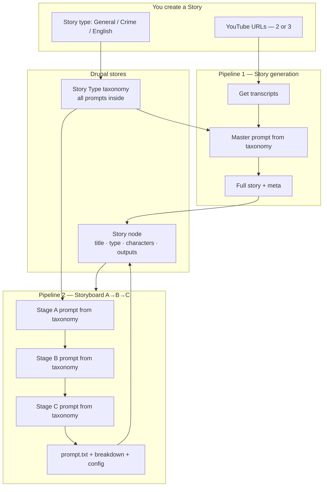
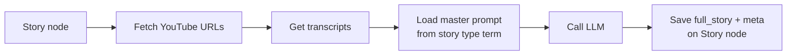
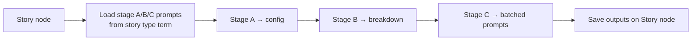
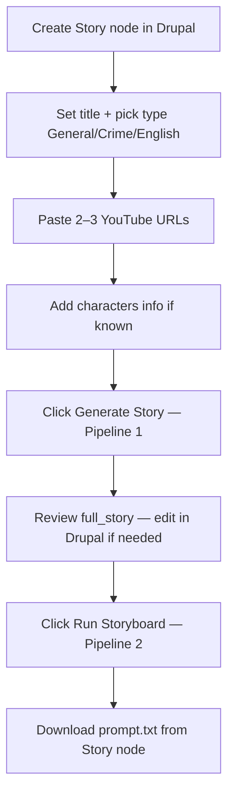

# Drupal Story Pipeline — Simple Flow

A minimal Drupal setup based on your sketch: **one taxonomy holds all prompts**, **one Story content type holds everything per episode**, and **two pipelines** run via API.

---

## The whole thing in one picture



---

## Drupal structure (only 2 things to build)

### 1. Taxonomy: **Story Type**

Three terms — create once, edit prompts in the UI:

| Term | Machine name |
|------|--------------|
| General | `general` |
| Crime | `crime` |
| English | `english` |

**Fields on each term** (use Full HTML or plain long text — paste your `.md` files here):

| Field | Machine name | What you paste |
|-------|--------------|----------------|
| Master prompt (story writing) | `field_master_prompt` | From `story-making-prompts/` — turns transcripts → script |
| Stage A config | `field_stage_a` | From `bifuracted-template/stage-a-story-config.md` |
| Stage B config | `field_stage_b` | From `bifuracted-template/stage-b-scene-breakdown.md` |
| Stage C config | `field_stage_c` | From `bifuracted-template/stage-c-image-motion.md` |
| Default characters | `field_default_characters` | From `bifuracted-template/character.txt` |
| Pipeline settings | `field_pipeline_settings` | JSON — model, tokens, batch size (from INI) |

**Example `field_pipeline_settings` JSON:**

```json
{
  "model": "deepseek-v4-pro",
  "scene_batch": 8,
  "max_tokens_a": 65536,
  "max_tokens_b": 131072,
  "max_tokens_c": 65536
}
```

> All prompts for General live on the **General** term. Same for Crime and English. No separate content types for templates.

---

### 2. Content type: **Story**

One node = one episode.

| Field | Machine name | Type | When filled |
|-------|--------------|------|-------------|
| Title | `title` | core | You create the node |
| Story type | `field_story_type` | Taxonomy ref → Story Type | You pick General / Crime / English |
| YouTube URLs | `field_youtube_urls` | Text (multi) | Pipeline 1 input — 2 or 3 URLs |
| Characters info | `field_characters_info` | Long text | You write or pipeline fills |
| Full story | `field_full_story` | Long text | **Pipeline 1 output** — or you paste manually |
| Story meta | `field_story_meta` | Long text | **Pipeline 1 output** — title ideas, length, angle, etc. |
| Stage A output | `field_stage_a_output` | Long text | Pipeline 2 output |
| Stage B output | `field_stage_b_output` | Long text | Pipeline 2 output |
| Prompt file | `field_prompt_file` | File | Pipeline 2 output — `prompt.txt` |
| Scene file | `field_scene_file` | File | Pipeline 2 output — `scene.txt` (optional) |
| Status | `field_status` | List | see status flow below |

**Status values:**

```
draft → story_generated → storyboard_running → storyboard_done → failed
```

---

## Two pipelines

### Pipeline 1 — Story generation

**Trigger:** `POST /api/story-pipeline/generate-story`  
**Input:** Story node ID (must have YouTube URLs + story type)



**Steps the worker runs:**

1. Read `field_youtube_urls` from Story node
2. Fetch transcripts (use existing `library/fetch_youtube_transcript.py` logic)
3. GET story type term → read `field_master_prompt`
4. Call LLM with: master prompt + combined transcripts + characters info
5. Parse output → save to `field_full_story` and `field_story_meta`
6. Set `field_status` = `story_generated`

**Output on Story node:**

- `field_full_story` — the Hindi/English narration script **[only story]**
- `field_story_meta` — title suggestions, operation name, length, hook, etc.

---

### Pipeline 2 — Storyboard (A → B → C)

**Trigger:** `POST /api/story-pipeline/run-storyboard`  
**Input:** Story node ID (must have `field_full_story`)



**Steps the worker runs:**

1. Read `field_full_story`, `field_characters_info`, story type
2. GET story type term → read `field_stage_a`, `field_stage_b`, `field_stage_c`, `field_default_characters`, `field_pipeline_settings`
3. Run existing `deepseek_pipeline.py` (Stages A → B → C)
4. Save outputs back to Story node:
   - `field_stage_a_output`
   - `field_stage_b_output`
   - `field_prompt_file` (upload `prompt.txt`)
   - `field_scene_file` (optional)
5. Set `field_status` = `storyboard_done`

---

## Your day-to-day flow



**Or skip Pipeline 1:** paste your own script into `field_full_story`, go straight to step 7.

---

## API (minimal — 4 endpoints)

| Method | Endpoint | Does |
|--------|----------|------|
| `POST` | `/api/story-pipeline/stories` | Create story node |
| `POST` | `/api/story-pipeline/generate-story` | Pipeline 1 — `{ "story_id": "42" }` |
| `POST` | `/api/story-pipeline/run-storyboard` | Pipeline 2 — `{ "story_id": "42", "max_step": 4 }` |
| `GET` | `/api/story-pipeline/stories/{id}` | Poll status + get outputs |

**Create story example:**

```json
POST /api/story-pipeline/stories
{
  "title": "London Case",
  "story_type": "crime",
  "youtube_urls": [
    "https://youtube.com/watch?v=...",
    "https://youtube.com/watch?v=..."
  ],
  "characters_info": "Chohan family — 4 members..."
}
```

**Poll until done:**

```json
GET /api/story-pipeline/stories/42

{
  "id": "42",
  "title": "London Case",
  "story_type": "crime",
  "status": "storyboard_done",
  "full_story": "...",
  "prompt_file_url": "https://.../prompt.txt"
}
```

---

## What the worker fetches (one bundle call)

Instead of many content types, one GET assembles everything:

```
GET /api/story-pipeline/stories/{id}/bundle?pipeline=storyboard
```

```json
{
  "story": {
    "title": "London Case",
    "full_story": "...",
    "characters_info": "...",
    "story_type": "crime"
  },
  "prompts": {
    "stage_a": "... markdown from taxonomy term ...",
    "stage_b": "...",
    "stage_c": "...",
    "characters": "...",
    "master_prompt": "..."
  },
  "settings": {
    "model": "deepseek-v4-pro",
    "scene_batch": 8
  }
}
```

Worker reads taxonomy fields from the story's type term — no separate prompt nodes.

---

## Map from your sketch → Drupal

| Your sketch | Drupal |
|-------------|--------|
| Youtube urls [2 or 3] | `Story.field_youtube_urls` |
| General / Crime / English | **Story Type** taxonomy |
| Master prompt for story | `Story Type.field_master_prompt` |
| Stage a/b/c config.md | `Story Type.field_stage_a/b/c` |
| Keep prompts in full html field | Long text / Full HTML on taxonomy term |
| Story content type — title | `Story.title` |
| Story content type — type | `Story.field_story_type` |
| Characters info | `Story.field_characters_info` |
| O/p full story with meta | `Story.field_full_story` + `field_story_meta` |
| [only story] | `field_full_story` (meta separate field) |

---

## Map from existing repo files → taxonomy terms

Do this once per story type (General, Crime, English):

| Copy from repo | Paste into taxonomy field |
|----------------|---------------------------|
| `story-making-prompts/crime-story-claude-8thjune` | Crime term → `field_master_prompt` |
| `story-making-prompts/general-story` | General term → `field_master_prompt` |
| `crime-section/bifuracted-template/stage-a-story-config.md` | Crime term → `field_stage_a` |
| `crime-section/bifuracted-template/stage-b-scene-breakdown.md` | Crime term → `field_stage_b` |
| `crime-section/bifuracted-template/stage-c-image-motion.md` | Crime term → `field_stage_c` |
| `crime-section/bifuracted-template/character.txt` | Crime term → `field_default_characters` |
| `crime-section/deepseek.config.example.ini` | Crime term → `field_pipeline_settings` (as JSON) |

Repeat for `general-story/` and `english-story/` on their terms.

---

## Simple vs detailed design

| | **Simple (this doc)** | **Detailed** ([README.md](./README.md)) |
|--|----------------------|----------------------------------------|
| Content types | 1 (Story) | 6 (Profile, Template, Library, Story, Run, Artifact) |
| Prompts stored | Taxonomy term fields | Separate Prompt Template nodes with revisions |
| Run tracking | Story `field_status` | Separate Pipeline Run + Run Step nodes |
| Best for | Small team, fast setup | Full audit trail, version pinning, batch ops |
| Start here? | **Yes** | Upgrade later if needed |

You can add Run nodes later without changing the taxonomy model.

---

## Build order for Cursor

1. Create vocabulary **Story Type** + 3 terms (General, Crime, English)
2. Add prompt fields on the taxonomy term
3. Create **Story** content type with fields above
4. Paste prompts from repo into each term (manual or Drush import)
5. Build API: create story, generate-story, run-storyboard, get story
6. Build Python worker in `drupal-worker/` — two commands: `generate_story`, `run_storyboard`
7. Wire existing `fetch_youtube_transcript.py` into Pipeline 1
8. Wire existing `deepseek_pipeline.py` into Pipeline 2

**One-liner for Cursor:**

> Build Drupal 10 with Story Type taxonomy (General/Crime/English) holding master prompt + stage A/B/C + characters + settings in HTML fields, and a Story content type (title, type, youtube urls, characters, full_story, meta, outputs). Expose 4 REST endpoints. Add Python worker that runs Pipeline 1 (transcripts → master prompt → story) and Pipeline 2 (A→B→C using taxonomy prompts). Follow `docs/drupal-story-pipeline/SIMPLE-FLOW.md`.

---

## Example: London case end-to-end

```
1. Create Story: title="London Case", type=Crime
2. Paste 2 YouTube URLs from research
3. Paste characters info from raw notes
4. POST generate-story → worker fetches transcripts, runs crime master prompt
5. Story gets full_story (91 lines) + meta (title: "Chohan Family London Murders...")
6. You tweak 2 lines in Drupal
7. POST run-storyboard → worker runs Stage A, B, C using Crime term prompts
8. Download prompt.txt from Story node → video production
```
